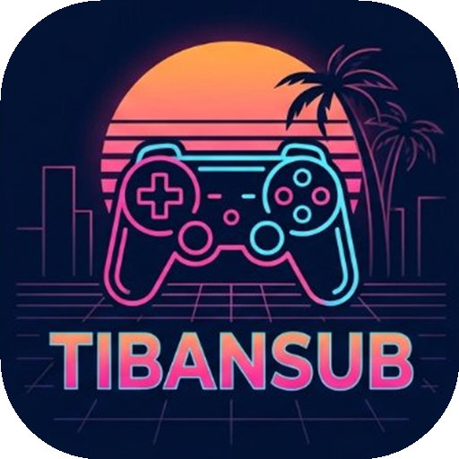

# TIBANSUB (All-in-One PS5/PS4 & Xbox Translator + Built-in TV Installer)

  

  <b>แอปแปลซับไตเติลเกมและพากย์เสียงไทยแบบเรียลไทม์ รองรับทั้ง PlayStation 5 / PS4 และ Xbox Series X|S / One ในแอปเดียว</b> 
  <i>ธีม Leonida Twilight Dusk (Liquid Glass) พร้อมตัวติดตั้งแอปทีวี Samsung (.wgt) และ Android TV (.apk) ในตัว</i>

---

## ดาวน์โหลด TIBANSUB (เวอร์ชันล่าสุด v1.2.3)

เลือกดาวน์โหลดไฟล์ที่ตรงกับอุปกรณ์ของคุณด้านล่างนี้ได้เลยครับ *(แนะนำให้โหลดไฟล์หลักสำหรับมือถือ Android เพียงไฟล์เดียว เพราะมีตัวติดตั้งแอปทีวีฝังอยู่ในตัวแล้ว)*

| ไฟล์ดาวน์โหลด | สำหรับอุปกรณ์ | คำอธิบาย |
| :--- | :--- | :--- |
| **[ดาวน์โหลด TIBANSUB.apk (ไฟล์หลัก — แนะนำ)](https://github.com/teeradream/tibansub_console/releases/latest/download/TIBANSUB.apk)** | **มือถือ / แท็บเล็ต Android** | แอปหลักสำหรับเชื่อมต่อ PS5/PS4/Xbox แปลซับสด พากย์ไทย และยิงติดตั้งแอปเข้าทีวี Samsung / Android TV ได้ในคลิกเดียว |
| **[ดาวน์โหลด TIBANSUB-Android-TV.apk](https://github.com/teeradream/tibansub_console/releases/latest/download/TIBANSUB-Android-TV.apk)** | **Android TV / Google TV** | แอปฝั่งทีวีสำหรับแสดงซับไทย 4K บนจอทีวี (สามารถกดส่งติดตั้งจากมือถือในแท็บ `ติดตั้งทีวี` ได้เลยโดยไม่ต้องโหลดแยก) |
| **[ดาวน์โหลด TIBANSUB-Samsung-TV.wgt](https://github.com/teeradream/tibansub_console/releases/latest/download/TIBANSUB-Samsung-TV.wgt)** | **Samsung Smart TV (Tizen)** | แอปฝั่งทีวี Samsung (ปกติไม่ต้องโหลดแยก แอปมือถือจะออกใบรับรองและติดตั้งเข้าทีวีให้โดยอัตโนมัติ) |
| **[ดูเวอร์ชันทั้งหมด (GitHub Releases)](https://github.com/teeradream/tibansub_console/releases)** | ทุกอุปกรณ์ | รวมไฟล์ติดตั้งและประวัติการอัปเดตย้อนหลังทั้งหมด |

> **หมายเหตุการอัปเดต:** เมื่อมีเวอร์ชันใหม่ สามารถกดปุ่ม **เช็กอัปเดต** ในหน้า `ตั้งค่า` เพื่ออัปเดตทับได้ทันที ข้อมูลการจับคู่ PS5, API Key และตั้งค่าทั้งหมดจะอยู่ครบ 100% และไม่จำเป็นต้องติดตั้งแอปบนทีวีใหม่

---

## วิดีโอสอนใช้งานแบบละเอียด (3 คลิป มีเสียงพากย์ไทย)

สามารถกดเล่นวิดีโอดูขั้นตอนทีละขั้นพร้อมเสียงพากย์ไทยบนหน้านี้ได้เลยครับ

### 1. แนะนำฟีเจอร์ทั้งหมด & การปรับแต่งหลังเชื่อมต่อ
แนะนำปุ่มควบคุมลอยในหน้าสตรีม (Quick Drawer ด้านบน, เมนู `☰`, 3 ปุ่มลัดขวาล่าง), วิธีเพิ่มและลากปรับกรอบอ่านซับ 3 แบบ (กรอบสีเขียวซับหลัก, กรอบสีฟ้าแปลเฉพาะจุดเอกสาร/เมนู, กรอบป๊อปอัปอัตโนมัติซ้าย/ขวา), การเลื่อนปรับความสูง-ต่ำของซับและกล่องซ้าย/ขวาแบบเรียลไทม์, โหมดแยกสีชื่อตัวละครอัตโนมัติ, เสียงพากย์ไทย TTS, โหมดทีวีจอดำสนิท 100% และคลังซับแยกตามหมวดหมู่เกม

https://github.com/user-attachments/assets/e1af2294-44da-4b51-a1da-9c3810313c39

### 2. วิธีเชื่อมต่อ PlayStation 5 แบบละเอียด
อธิบายหลักการระบบ 2 บัญชี PSN เพื่อไม่ให้แย่งจอย DualSense, ขั้นตอนเปิด Remote Play และขอรหัส PIN 8 หลักบนเครื่อง PS5, การกด `ล็อกอิน PSN` ในแอปเพื่อดึงรหัส Base64 Account ID อัตโนมัติ, การกรอก PIN 8 หลักจับคู่ถาวร และวิธีสลับกลับบัญชีหลักเพื่อเข้าเล่นจริง

https://github.com/user-attachments/assets/bbcaf083-6d26-4f3c-bab2-d64966c42c35

### 3. วิธีลงแอปในทีวี Samsung แบบละเอียด (ไม่ต้องใช้คอม)
วิธีดูเลข Host IP บนมือถือ, ขั้นตอนเปิดหน้า Apps บนทีวี Samsung และกดรีโมต `1-2-3-4-5` เปิด Developer Mode, การกดปุ่มเปิด/ปิดบนรีโมตค้างไว้ 5 วินาทีเพื่อรีสตาร์ทเปิดพอร์ต `26101`, การสแกนหาทีวี, ล็อกอิน Samsung Account 1 ครั้ง และกดติดตั้ง `.wgt` คลิกเดียวจนแอปเปิดขึ้นบนทีวีอัตโนมัติ

https://github.com/user-attachments/assets/136a039a-d4a6-4d4b-bb02-720330baa43f

---

## ไฮไลต์ฟีเจอร์ทั้งหมดของ TIBANSUB

1. **รองรับทั้ง PlayStation และ Xbox ในแอปเดียว**
   - **PlayStation 5 / PS4:** ใช้ Engine หลังบ้าน `libchiaki` ความหน่วงต่ำ พร้อมระบบ **ล็อกอินดึง PSN Account ID อัตโนมัติในแอป** และหน้าจับคู่รหัส PIN 8 หลักสไตล์ Glassy OTP
   - **Xbox Series X|S & Xbox One:** เชื่อมต่อผ่านบัญชี Microsoft OAuth2 และสตรีมภาพผ่าน **Xbox Home Console WebRTC** เข้าสู่ระบบแปลภาษากลางตัวเดียวกันทันที
2. **ปรับแต่งซับและกรอบอ่านข้อความได้อิสระหลังเชื่อมต่อ**
   - เพิ่มและลากย่อขยายกรอบจับซับได้ 3 รูปแบบ: กรอบซับหลักสีเขียว, กรอบแปลเฉพาะจุดสีฟ้า (เอกสาร/เมนู) และกรอบป๊อปอัปอัตโนมัติซ้าย/ขวา
   - ปรับความสูง-ต่ำซับหลัก (`0–100%`), ปรับความสูง-ต่ำกล่องซ้าย/ขวา, ขนาดฟอนต์ (`10–80 sp`), สีซับ 6 สี, **สีชื่อตัวละคร (สีเดียวกับซับ / กำหนดเอง / แยกสีอัตโนมัติ 0ms)** และความโปร่งแสงพื้นหลัง ซิงก์สดทั้งมือถือและทีวี
3. **คลังซับออฟไลน์ 0ms แยกตามหมวดหมู่เกม + AI 7 ค่าย**
   - รองรับ Gemini AI, Groq, Cerebras, OpenAI, OpenRouter, Custom Endpoint และ Google Translate ฟรี
   - สร้างหมวดหมู่เกมและนำเข้าไฟล์ซับ `.db` / `.tsv` แยกแต่ละเกมได้เอง พร้อมปุ่ม **เช็กอัปเดต** ในหน้าตั้งค่า
4. **ฝังแอปทีวีทั้ง Samsung (`.wgt`) และ Android TV (`.apk`) มาพร้อมในตัวแอปเดียว**
   - **Samsung Smart TV (Tizen):** เชื่อมต่อ SDB พอร์ต `26101` อ่านค่า `DUID`, ออกใบรับรอง VD CA อัตโนมัติ, เซ็นไฟล์ `.wgt` และยิงติดตั้งพร้อมเปิดแอปบนทีวีในคลิกเดียว
   - **Android TV / Google TV:** ยิงติดตั้งไฟล์ APK ที่ฝังอยู่ในแอปผ่าน **Wireless ADB** ในคลิกเดียว หรือดาวน์โหลดผ่าน Wi-Fi บ้าน (`http://<IP-มือถือ>:8792/tv.apk`)

---

## การบิลด์โปรเจกต์ (Local & GitHub Actions)

เมื่อ Push ขึ้น GitHub Repository ระบบ `.github/workflows/android.yml` จะทำการ:
1. บิลด์แอปฝั่ง Android TV (`:android-tv:assembleDebug`) และแพ็กแอปฝั่ง Samsung Tizen (`packageTizenWgt`)
2. ฝังไฟล์ทั้งคู่เข้าสู่ `app/src/main/assets/tv/` อัตโนมัติ
3. คอมไพล์ `libchiaki` NDK และสร้างไฟล์ **`TIBANSUB.apk`** แบบ All-in-One ขึ้นหน้า GitHub Releases ทันที

## License
พัฒนาต่อยอดภายใต้สัญญาอนุญาตโอเพนซอร์ส **AGPLv3 / GPLv3**
